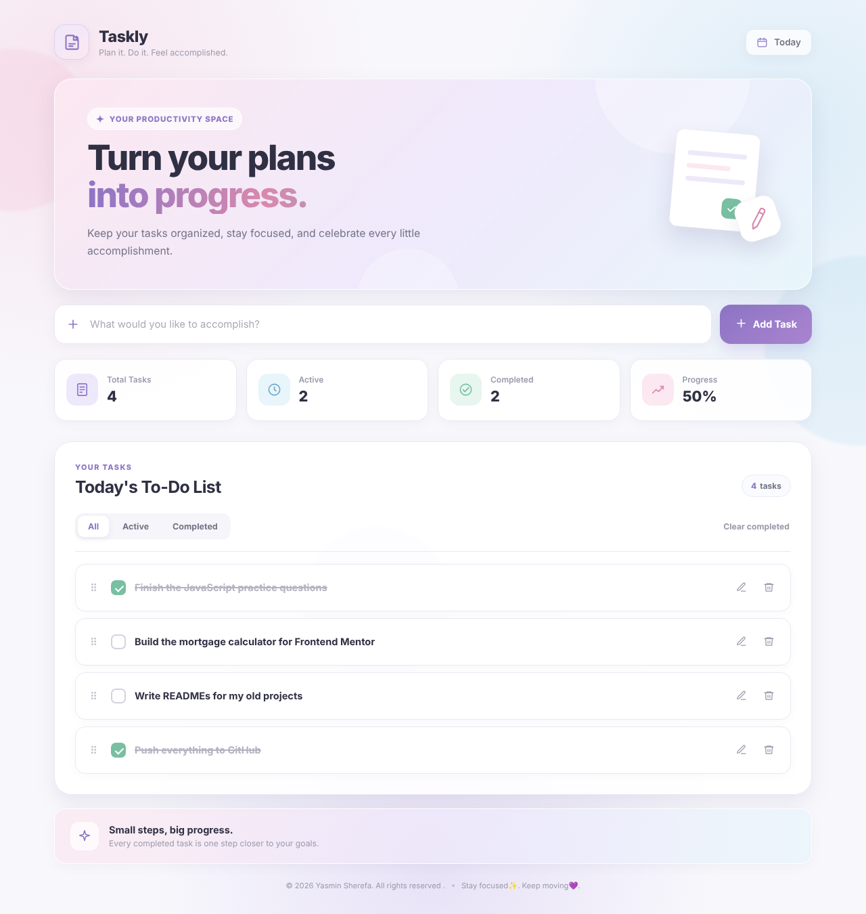
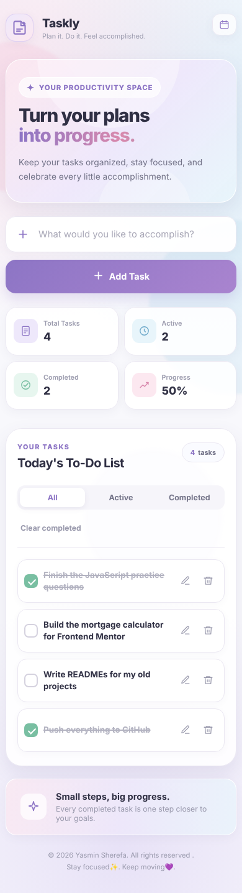

# Taskly | Smart Todo List

A clean, colourful todo app to plan your day, track your progress and celebrate every finished task. Built with **plain HTML, CSS and JavaScript**, with no frameworks or libraries.

**Live demo:** [yasmin3802.github.io/shiera-m2w3](https://yasmin3802.github.io/shiera-m2w3/)

| Desktop | Mobile |
| --- | --- |
|  |  |

## Features

- **Add tasks** with a form (empty or whitespace-only tasks are ignored, 120 character limit)
- **Complete tasks** with a checkbox, and finished tasks get a strikethrough
- **Edit tasks in place**: click the pencil, press `Enter` to save, `Esc` to cancel
- **Delete tasks** with one click
- **Filter** the list by *All*, *Active* or *Completed*
- **Clear completed** tasks in one go
- **Live statistics**: total, active, completed and a progress percentage, all updated instantly
- **Drag and drop** to reorder tasks (also works while a filter is on)
- **Saved automatically** in your browser with `localStorage`, so your tasks are still there after a refresh
- **Friendly empty states** with a different message for each filter
- **Responsive** layout for desktop, tablet and phone
- **Accessible**: labelled buttons and checkboxes, a polite live region for the list, and reduced-motion support

## Built with

- **HTML5**: semantic structure (`header`, `main`, `section`, `form`, `footer`)
- **CSS3**: Flexbox and Grid layouts, custom properties (CSS variables) for the colour palette, shadows and radii, responsive breakpoints at 900px, 700px and 480px, and soft gradients with rounded, layered cards
- **Vanilla JavaScript (ES6+)**: DOM manipulation, event delegation, `localStorage`, and the HTML5 Drag and Drop API

## How it works

All the data lives in one array of task objects, and the screen is redrawn from it every time something changes:

```js
{ id: "a1b2-...", title: "Write READMEs", done: false }
```

1. A user action (add, toggle, edit, delete, filter, reorder) updates the `todos` array.
2. `persist()` saves the array to `localStorage`.
3. `render()` rebuilds the list and updates the statistics.

Some details I'm proud of:
- Updates are **immutable**: I use `map`, `filter` and spread (`...`) to create new arrays instead of changing the old one.
- One click listener on the list handles every checkbox, edit and delete button (**event delegation**), instead of adding a listener to each task.
- Saved data is checked when the page loads, so a broken `localStorage` value can't crash the app.
- Task titles are inserted with `textContent`, never as raw HTML.

## Project structure

```
shiera-m2w3/
├── index.html
├── style.css
├── app.js
├── screenshots/
│   ├── desktop.png
│   └── mobile.png
└── README.md
```

## Run it locally

No install or build step is needed.

1. Clone the repository:
   ```bash
   git clone https://github.com/yasmin3802/shiera-m2w3.git
   ```
2. Open the folder and double-click `index.html`, or use the **Live Server** extension in VS Code.

## What I learned

- Keeping a single source of truth (one array) and re-rendering the screen from it
- Writing small, focused functions for each action
- Updating arrays without mutating them
- Using `localStorage` safely with `JSON.parse` inside `try/catch`
- Building accessible controls with `aria-label` and a live region
- Using the Drag and Drop API and syncing the new order back into the data

## Ideas for the future

- Show the real date in the header (it currently says "Today")
- Reorder tasks with the keyboard, and drag support for touch screens
- Due dates and categories
- A dark mode

## Author

**Yasmin Sherefa**
GitHub: [@yasmin3802](https://github.com/yasmin3802)

Built as part of the Shiera Full-Stack Mentorship (Module 2, Week 3).